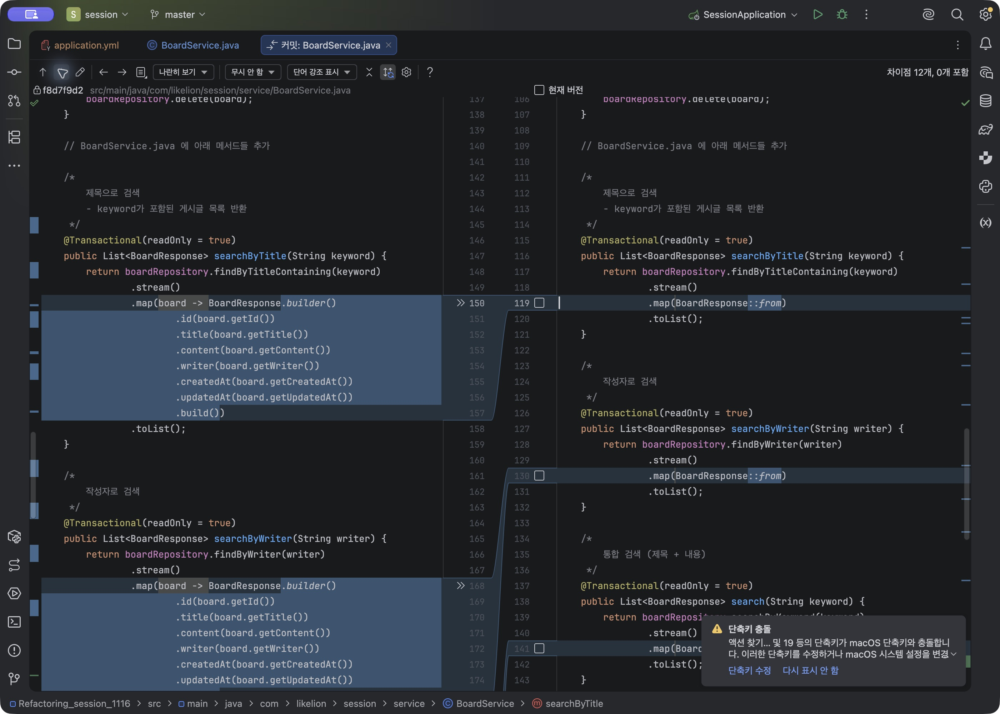
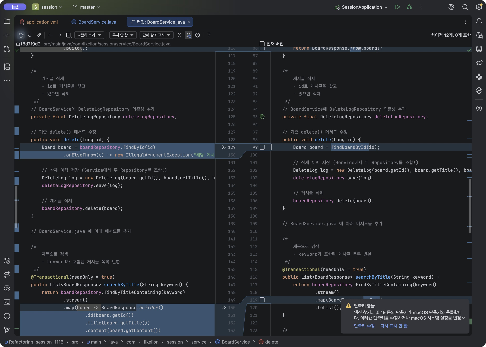
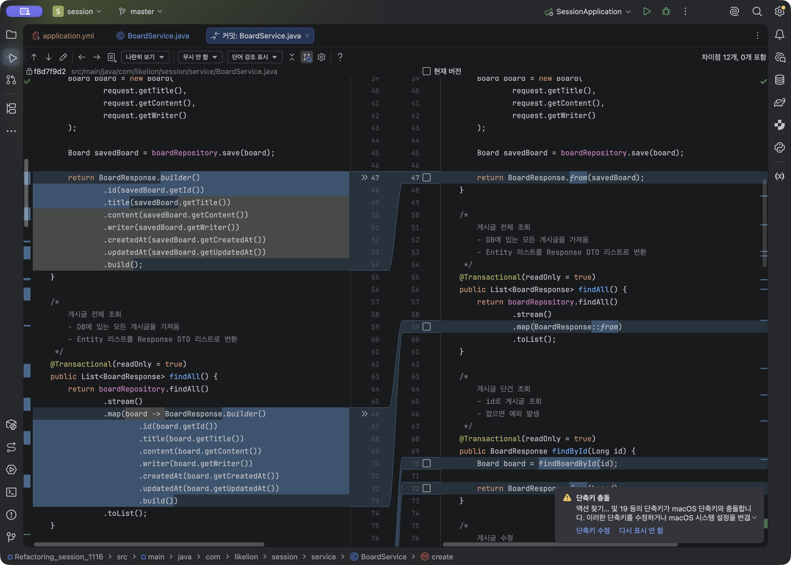
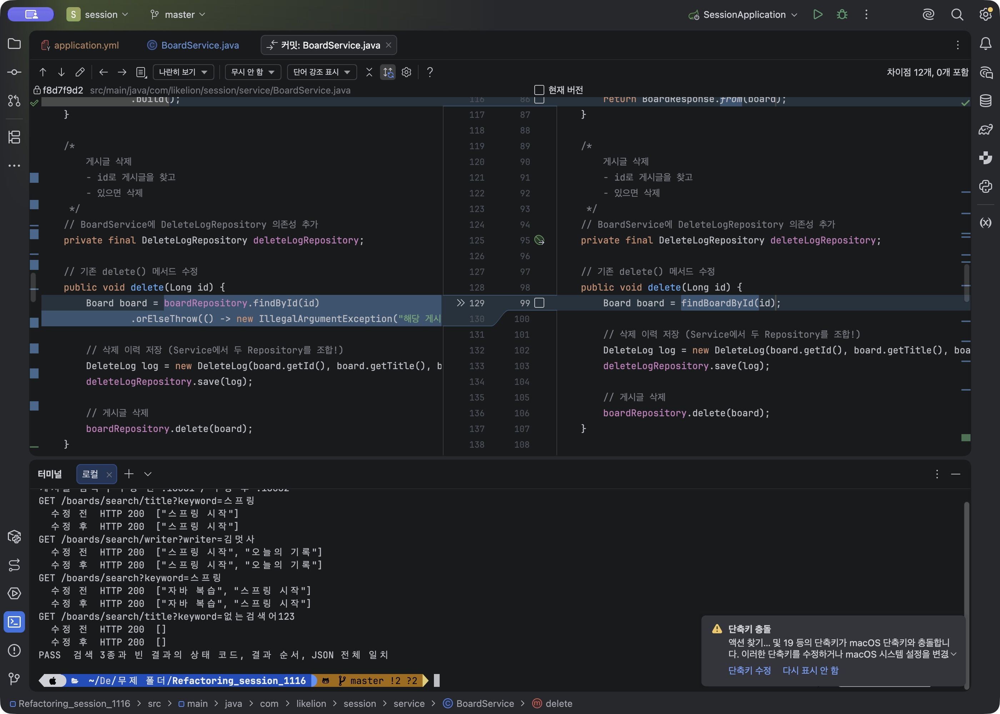
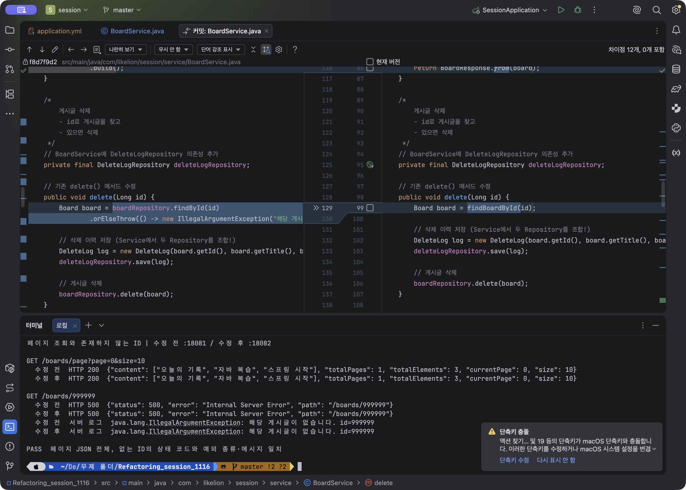
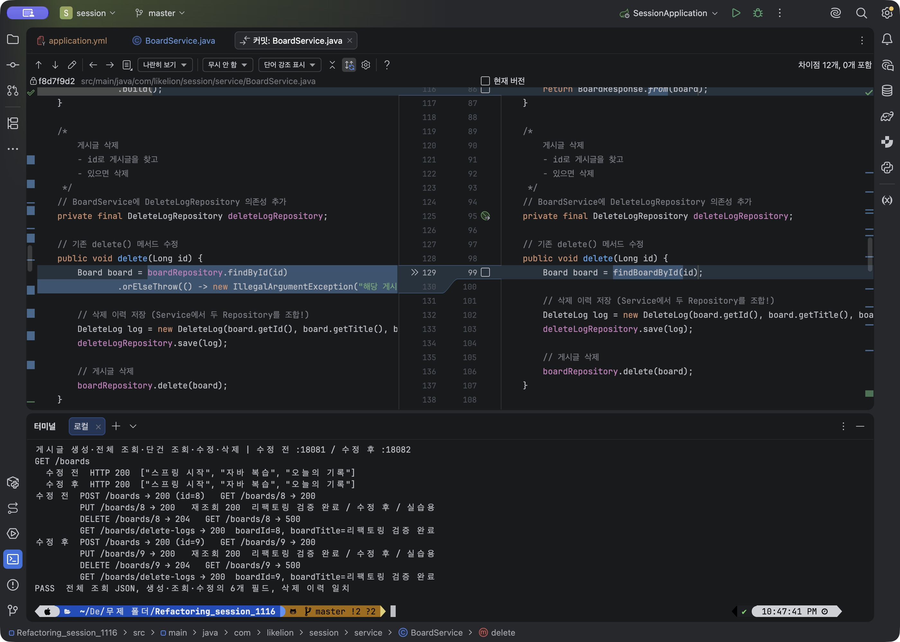

# 클린코드 & 리팩토링 세션 과제

## 📌 기본 정보

- 이름 · 유승열
- 제출일 · 2026/11/22
- 작업 브랜치 / 레포 링크 · `codex/clean-code-refactoring` / https://github.com/yuseungyeol-823/Refactoring_session_1116/tree/codex/clean-code-refactoring

---

## 1️⃣ 개념 정리

### 클린코드란?

코드를 읽는 사람이 이름과 구조를 통해 의도와 흐름을 이해하고, 수정할 위치를 찾기 쉬운 코드다.

### 리팩토링이란?

외부에서 관찰할 수 있는 동작을 유지하면서 코드의 내부 구조를 개선하는 작업이다. 이번 작업에서는 기존 게시글 API의 응답을 확인하면서 중복된 변환과 조회 로직을 메서드로 모았다.

### 리팩토링과 기능 추가의 차이는?

반복된 응답 변환을 `BoardResponse.from()`으로 모으는 것은 리팩토링이다. 제목 검색에 본문 검색을 추가하면 사용자가 받는 검색 결과가 달라지므로 기능 추가에 해당한다.

### 수정 전에 동작을 확인하는 이유는?

변경 전 요청과 응답을 기록하면 수정 후 비교할 기준이 생긴다. 같은 데이터와 요청으로 상태 코드, 응답 필드와 값, 결과 순서와 예외를 비교해 의도하지 않은 동작 변경을 확인할 수 있다.

---

## 2️⃣ 개선 사례

### 사례 1 — 수업 사례 (`BoardResponse.from()` / `findBoardById()`)

**변경 전 코드**

검색과 페이지 조회에서 같은 응답 매핑이 반복됐다. 아래는 제목 검색 메서드다.

```java
@Transactional(readOnly = true)
public List<BoardResponse> searchByTitle(String keyword) {
    return boardRepository.findByTitleContaining(keyword)
            .stream()
            .map(board -> BoardResponse.builder()
                    .id(board.getId())
                    .title(board.getTitle())
                    .content(board.getContent())
                    .writer(board.getWriter())
                    .createdAt(board.getCreatedAt())
                    .updatedAt(board.getUpdatedAt())
                    .build())
            .toList();
}
```

단건 조회·수정·삭제에서는 다음 조회와 예외 처리가 반복됐다.

```java
Board board = boardRepository.findById(id)
        .orElseThrow(() -> new IllegalArgumentException("해당 게시글이 없습니다. id=" + id));
```

## **문제**

- 검색 3종과 페이지 조회에서 같은 여섯 필드를 반복해서 채웠다. 필드를 추가하거나 매핑을 바꾸려면 네 곳을 각각 수정해야 했다.
- 단건 조회·수정·삭제에도 ID 조회와 미존재 예외 처리가 중복돼 있었다.

**변경 후 코드**

`BoardResponse`에 응답 변환 메서드를 추가했다.

```java
public static BoardResponse from(Board board) {
    return BoardResponse.builder()
            .id(board.getId())
            .title(board.getTitle())
            .content(board.getContent())
            .writer(board.getWriter())
            .createdAt(board.getCreatedAt())
            .updatedAt(board.getUpdatedAt())
            .build();
}
```

검색 3종과 페이지 조회의 매핑에 `BoardResponse::from`을 적용했다. 제목 검색은 다음과 같이 바뀌었다.

```java
@Transactional(readOnly = true)
public List<BoardResponse> searchByTitle(String keyword) {
    return boardRepository.findByTitleContaining(keyword)
            .stream()
            .map(BoardResponse::from)
            .toList();
}
```

ID 조회와 실패 처리는 `private` 메서드로 추출하고, 단건 조회·수정·삭제에서 호출했다.

```java
private Board findBoardById(Long boardId) {
    return boardRepository.findById(boardId)
            .orElseThrow(() -> new IllegalArgumentException("해당 게시글이 없습니다. id=" + boardId));
}

// 단건 조회·수정·삭제의 조회 부분
Board board = findBoardById(id);
```

## **개선점** (어떤 변경이 쉬워졌는지)

- 검색 메서드에서 조회 조건과 응답 변환 흐름이 잘 보인다.
- 게시글 응답 매핑은 `BoardResponse.from()` 한곳에서 확인할 수 있다.
- 조회·수정·삭제의 ID 조회와 예외 처리를 `findBoardById()`에서 확인할 수 있다.
- 공개 메서드와 클래스의 기존 트랜잭션 설정, 삭제 이력 저장 후 게시글 삭제 순서를 유지했다.

## **확인 방법**

IntelliJ 내장 터미널에서 시작 코드와 최종 코드 서버에 같은 요청을 보냈다. 검색 3종과 페이지 조회의 JSON, 빈 결과, 없는 ID의 HTTP 상태 코드와 서버 로그의 예외 종류·메시지를 비교했다.





### 사례 2 — 직접 찾은 사례

**변경 전 코드**

수업 실습을 적용한 뒤에도 `create()`, `findAll()`, `findById()`, `update()`에 같은 빌더가 남아 있었다. 아래는 생성 메서드다.

```java
public BoardResponse create(BoardCreateRequest request) {
    Board board = new Board(
            request.getTitle(),
            request.getContent(),
            request.getWriter()
    );

    Board savedBoard = boardRepository.save(board);

    return BoardResponse.builder()
            .id(savedBoard.getId())
            .title(savedBoard.getTitle())
            .content(savedBoard.getContent())
            .writer(savedBoard.getWriter())
            .createdAt(savedBoard.getCreatedAt())
            .updatedAt(savedBoard.getUpdatedAt())
            .build();
}
```

## **문제**

동일한 `BoardResponse`를 만드는 규칙이 여러 곳에 남아 있었다. 응답 필드를 한쪽에서만 수정하면 API마다 응답 필드가 달라질 수 있었다.

**변경 후 코드**

```java
public BoardResponse create(BoardCreateRequest request) {
    Board board = new Board(
            request.getTitle(),
            request.getContent(),
            request.getWriter()
    );

    Board savedBoard = boardRepository.save(board);

    return BoardResponse.from(savedBoard);
}

@Transactional(readOnly = true)
public List<BoardResponse> findAll() {
    return boardRepository.findAll()
            .stream()
            .map(BoardResponse::from)
            .toList();
}

@Transactional(readOnly = true)
public BoardResponse findById(Long id) {
    Board board = findBoardById(id);

    return BoardResponse.from(board);
}

public BoardResponse update(Long id, BoardUpdateRequest request) {
    Board board = findBoardById(id);

    board.update(request.getTitle(), request.getContent());

    return BoardResponse.from(board);
}
```

## **개선점** (어떤 변경이 쉬워졌는지)

게시글 응답 필드를 추가하거나 매핑을 바꿀 때 `BoardResponse.from()`을 수정하면 생성·조회·수정·검색·페이지 조회에 함께 반영된다. 각 서비스 메서드에는 저장, 조회, 수정 같은 처리 흐름이 더 잘 드러난다.

## **확인 방법**

전체 조회는 수정 전후의 JSON을 그대로 비교했다. 생성·조회·수정은 각 서버에 새 게시글을 만들어 응답의 여섯 필드를 확인했다. 제목과 내용을 수정하고 다시 조회해 저장 여부와 작성자 유지 여부도 확인했다.



---

## 3️⃣ 동작 확인 (3개 이상)

실습용 MySQL 데이터에 연결한 시작 코드와 최종 코드에 IntelliJ 내장 터미널에서 실제 HTTP 요청을 보냈다. 게시글 응답의 `id`, `title`, `content`, `writer`, `createdAt`, `updatedAt`을 확인했다.

| # | 확인 항목 | 요청 | 비교한 내용 (한 줄) | 결과 |
| --- | --- | --- | --- | --- | --- |
| 1 | 정상 검색 | `GET /boards/search/title?keyword=스프링` | 두 서버 모두 200과 “스프링 시작” 1건, 응답 여섯 필드와 값이 일치했다. | ✅ |
| 2 | 빈 결과 | `GET /boards/search/title?keyword=없는검색어123` | 두 서버 모두 200과 `[]`를 반환했다. | ✅ |
| 3 | 없는 ID | `GET /boards/999999` | 두 서버 모두 500. 서버 로그의 예외 종류와 메시지가 일치했다. | ✅ |
| 4 | 수정 | `PUT /boards/{id}` | 수정 후 재조회에서 제목 “리팩토링 검증 완료”, 내용 “수정 후”, 작성자 “실습용”을 확인했다. | ✅ |
| 5 | 삭제 | `DELETE /boards/{id}` | 삭제 204, 재조회 500. 삭제 이력에 게시글 ID·제목·작성자가 남았다. | ✅ |
| 6 | 페이지 조회 | `GET /boards/page?page=0&size=10` | 게시글 3건과 `totalPages=1`, `totalElements=3`, `currentPage=0`, `size=10`이 일치했다. | ✅ |

없는 ID의 오류 메시지는 서버 로그에서 확인했다. HTTP 응답 본문은 `status`, `error`, `path`가 일치했고, 요청마다 달라지는 `timestamp`는 비교에서 제외했다. 생성·수정·삭제에는 매번 새 게시글을 사용했으므로 새로 발급된 ID와 시각은 구조와 처리 결과를 중심으로 확인했다.

**스크린샷**

### 정상 검색·빈 결과

검색 3종의 결과와 순서, 빈 검색의 `[]`를 수정 전후로 비교했다.



### 페이지 조회와 없는 ID 캡처

페이지 정보와 HTTP 500, 서버 로그의 예외 종류·메시지를 수정 전후로 비교했다.



### 생성·조회·수정·삭제 캡처

수정 후 재조회 값과 삭제 상태 코드, 삭제 이력을 확인했다.



Gradle의 `test`와 `bootJar`도 통과했다.

---

## 💬 느낀 점 / 질문

중복된 응답 변환을 한곳에 모으니 서비스 메서드에서 조회와 저장, 수정의 흐름을 읽기 쉬워졌다. 특히 수업에서 다룬 검색뿐 아니라 생성과 조회에도 같은 변환 코드가 남아 있어, 같은 이유로 바뀌는 코드를 함께 살펴볼 필요가 있다는 점을 확인했다.

리팩토링 후 코드를 읽어보는 것에 더해 같은 요청을 실제로 실행하면서, 검색 결과와 예외가 유지되는지 확인하는 과정도 중요하다고 느꼈다.
